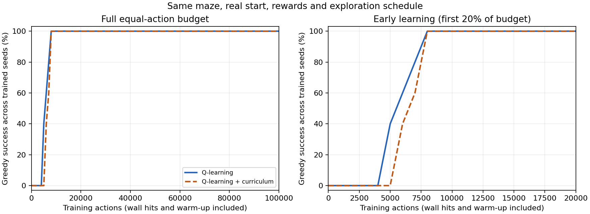

# Curriculum Learning — ผลระยะที่ 4

รันเมื่อ 2026-10-18T15:44:51.032131+07:00 (UTC+07:00) เปิดหน้านี้เป็นรายงานหลักได้เลย ส่วน logs/ และ models/ เป็นหลักฐานประกอบ

## เปรียบเทียบด้วยงบเท่ากัน

| ตัวชี้วัด | Q-learning ปกติ | Q-learning + Curriculum |
|---|---:|---:|
| ก้าวฝึกต่อ seed รวม warm-up และชนกำแพง | 100,000 | 100,000 |
| โมเดลที่สำเร็จเมื่อจบงบ | 5/5 | 5/5 |
| Success rate สุดท้าย | 100.00% | 100.00% |
| ก้าวเฉลี่ยเมื่อทดสอบสุดท้าย รวมล้มเหลว | 18.00 | 18.00 |
| รางวัลเฉลี่ยเมื่อทดสอบสุดท้าย | 83.00 | 83.00 |
| ก้าวฝึกเฉลี่ยที่พบ greedy success ครั้งแรก* | 5,800.00 | 6,800.00 |
| โมเดลที่เคยพบ greedy success | 5/5 | 5/5 |
| ก้าวเริ่มต้นเฉลี่ยของ success 3 จุดประเมินติดกัน* | 6,800.00 | 7,200.00 |
| โมเดลที่มี success 3 จุดประเมินติดกัน | 5/5 | 5/5 |

*เป็นเวลาที่สังเกตพบจากกริดประเมิน ไม่ใช่ก้าวแรกที่เรียนรู้ได้อย่างแน่นอน ค่าเฉลี่ยคิดเฉพาะ seeds ที่พบเกณฑ์ ต้องอ่านคู่กับจำนวนโมเดลที่พบเกณฑ์ ไม่ใช่เวลารันเครื่องหรือจำนวน episode และ success 3 จุดติดกันไม่ได้รับประกันว่าจะสำเร็จตลอดจากนั้น

ในการตั้งค่าชุดนี้ Curriculum ไม่ได้ช่วยให้พบความสำเร็จเร็วขึ้น โดยใช้ก้าวฝึกถึงจุดที่สังเกตพบ success ครั้งแรกเฉลี่ยมากกว่า 1,000 ก้าว จึงไม่ควรสรุปว่าการเพิ่ม Curriculum ทำให้ดีขึ้นเสมอ

สมมติฐานที่ควรตรวจในงานต่อไปคือเวลาที่ใช้ฝึกจากจุดเริ่มใกล้/กลางอาจไม่คุ้มสำหรับเขาวงกตขนาดนี้ แต่การรันนี้เพียงอย่างเดียวยังยืนยันสาเหตุไม่ได้ ไม่เปลี่ยนเงื่อนไขการฝึกภายหลังเพื่อให้ผลรันนี้ดูดีขึ้น

## กราฟการเรียนรู้จากจุดเริ่มจริง



แกน X นับเฉพาะ action ฝึก รวมช่วงเริ่มใกล้เป้าหมาย การประเมินแยกต่างหากและไม่ถูกนับเป็นข้อมูลฝึก กราฟซ้ายแสดงเต็มงบ กราฟขวาขยาย 20% แรก

## Curriculum ทำอย่างไร

1. near: สุ่มจุดเริ่มที่ระยะทางเดินสั้นสุดถึงเป้าหมาย 1–4 ช่อง
2. middle: สุ่มจุดเริ่มที่ระยะ 5–10 ช่อง
3. real_start: กลับไปเริ่มจาก S เดิมทุก episode

เลื่อนระดับเมื่อสำเร็จอย่างน้อย 80% ใน 50 episode ฝึกล่าสุดของระดับนั้น หรือเมื่อใช้งบในระดับ warm-up ครบ 20,000 action โดยตรวจ cap ที่ขอบ episode จึงอาจเกิน cap ได้ไม่เกินขนาดหนึ่ง episode ทั้งหมดนับรวมอยู่ในงบหลักเท่าเดิม ไม่มี reset epsilon เมื่อเลื่อนระดับ

ผู้สอนใช้ BFS อ่านแผนที่เพื่อจัดกลุ่มจุดเริ่มตามระยะทางจริงที่หลบกำแพง นี่เป็นข้อมูลเพิ่มเติมที่ Curriculum ใช้เลือกบทเรียน Agent ไม่ได้รับระยะทาง แผนที่ หรือเส้นทางเฉลยเป็น observation และไม่มีโบนัสสำรวจในระยะนี้

ทั้งสองวิธีใช้ alpha=0.1, gamma=0.95 และ epsilon ตามจำนวน action ฝึก: เริ่ม 1.0 คูณ 0.99995 ต่อ action ต่ำสุด 0.05 วิธีนี้ต่างจากระยะที่ 3 ที่ลด epsilon ต่อ episode จึงฝึก plain ใหม่พร้อมกันและไม่เทียบความเร็วกับไฟล์เก่าโดยตรง

## ผลแยก seed

| วิธี | Seed | Training actions | พบสำเร็จครั้งแรก* | ผลสุดท้าย | ก้าวสุดท้าย | ระดับฝึกท้ายสุด |
|---|---:|---:|---:|---|---:|---|
| plain | 0 | 100,000 | 5,000.00 | สำเร็จ | 18 | real_start |
| plain | 1 | 100,000 | 6,000.00 | สำเร็จ | 18 | real_start |
| plain | 2 | 100,000 | 5,000.00 | สำเร็จ | 18 | real_start |
| plain | 3 | 100,000 | 6,000.00 | สำเร็จ | 18 | real_start |
| plain | 4 | 100,000 | 7,000.00 | สำเร็จ | 18 | real_start |
| curriculum | 0 | 100,000 | 7,000.00 | สำเร็จ | 18 | real_start |
| curriculum | 1 | 100,000 | 8,000.00 | สำเร็จ | 18 | real_start |
| curriculum | 2 | 100,000 | 6,000.00 | สำเร็จ | 18 | real_start |
| curriculum | 3 | 100,000 | 6,000.00 | สำเร็จ | 18 | real_start |
| curriculum | 4 | 100,000 | 7,000.00 | สำเร็จ | 18 | real_start |

## ประวัติเลื่อนระดับจากการฝึก

| Seed | ระดับ | Training actions สะสม | Training success / จำนวนรอบ | เหตุผล |
|---|---|---:|---|---|
| 0 | near → middle | 3,249 | 88% / 50 รอบ | success_threshold |
| 0 | middle → real_start | 5,740 | 98% / 50 รอบ | success_threshold |
| 1 | near → middle | 2,627 | 96% / 50 รอบ | success_threshold |
| 1 | middle → real_start | 5,618 | 96% / 50 รอบ | success_threshold |
| 2 | near → middle | 2,894 | 90% / 50 รอบ | success_threshold |
| 2 | middle → real_start | 5,671 | 98% / 50 รอบ | success_threshold |
| 3 | near → middle | 2,728 | 92% / 50 รอบ | success_threshold |
| 3 | middle → real_start | 5,247 | 100% / 50 รอบ | success_threshold |
| 4 | near → middle | 3,127 | 94% / 50 รอบ | success_threshold |
| 4 | middle → real_start | 5,641 | 98% / 50 รอบ | success_threshold |

## ตอนโชว์ในคลาส

เปิด play.cmd เลือก **Q-learning** หรือ **Curriculum** แล้วกด **ให้ Q เดิน** โมเดลเริ่มต้นทั้งสองมาจาก seed แรกที่กำหนดไว้ล่วงหน้า ภายใต้งบฝึกเท่ากัน ไม่ได้เลือก seed ที่ดีที่สุด สามารถโหลด snapshot ใน models/ เพื่อดูผลระหว่างฝึกที่จำนวน action ตรงกัน

นำเสนอหน้าจอเดโมกับรายงานนี้พอ ไฟล์ comparison.csv มีตารางย่อ ส่วนข้อมูลทุก episode/จุดประเมิน/การเลื่อนระดับอยู่ใน logs/

## ขอบเขตและความยุติธรรมในการทดลอง

- ฝึกและประเมินบนแผนที่เดียว เป้าหมายเดิม ประเมินจาก S จริงเสมอ ไม่มีการใช้จุดเริ่มใกล้เป้าหมายทำให้คะแนนประเมินสูงขึ้น
- ทดสอบสุดท้ายหนึ่ง rollout ต่อ training seed เพราะ greedy policy และ Environment เป็น deterministic การทดสอบซ้ำโมเดลเดิมไม่ใช่ข้อมูลอิสระเพิ่ม
- ทั้งสองเริ่ม Q=0, ใช้ seeds [0, 1, 2, 3, 4] และ Q-learning update/รางวัล/ชุด action เดียวกัน เลือกทิศชนกำแพงได้
- กำหนดงบ schedule เงื่อนไขเลื่อนระดับ และ checkpoint ไว้ล่วงหน้า การประเมินไม่อัปเดต Q/RNG ไม่เลื่อนระดับ ไม่ใช้หยุดฝึกหรือเลือกโมเดลที่ดีที่สุด
- episode ที่ถูกตัดกลางทางเพราะงบหลักหมดแยกเป็น budget_cutoff ไม่ถือว่าถึงเป้าหมายหรือสำเร็จจากเวลาหมด และไม่ใช้ตัดสินเลื่อนระดับ
- teacher มีความรู้แผนที่สำหรับเลือกจุดเริ่ม จึงไม่ควรอ้างว่าทั้งสองวิธีได้รับข้อมูลเท่ากันทุกด้าน แม้มีงบ action ฝึกเท่ากัน
- ผลไม่ได้พิสูจน์ว่า Curriculum ดีกว่าในทุกโจทย์ และไม่ได้ทดสอบเขาวงกตใหม่

## ทำซ้ำ

```powershell
python curriculum.py --budget 100000 --seeds 0 1 2 3 4 --max-steps 300 --eval-every 1000 --alpha 0.1 --gamma 0.95 --epsilon-start 1.0 --epsilon-min 0.05 --epsilon-decay 0.99995 --easy-radius 4 --medium-radius 10 --window 50 --threshold 0.8 --stage-cap 20000
```

ใช้ --no-plot ได้หากไม่มี Matplotlib; ส่วนฝึกและหน้าจอหลักใช้ standard library เท่านั้น รันใหม่สร้างโฟลเดอร์ใหม่ ไม่ทับหลักฐานเดิม
