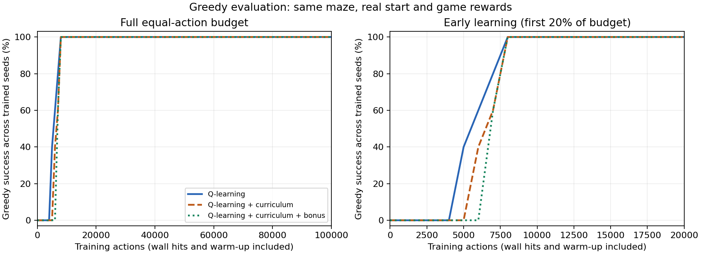

# Exploration Bonus — ผลระยะที่ 5

รันเมื่อ 2026-10-18T16:06:26.821321+07:00 (UTC+07:00) ใช้หน้านี้กับหน้าจอเดโมนำเสนอได้เลย

## ผลเปรียบเทียบ

ฝึกใหม่ทุกวิธีจาก Q=0 ด้วย seeds [0, 1, 2, 3, 4] วิธีละ 5 โมเดล งบ 100,000 action ต่อโมเดล

| ตัวชี้วัด | Q ปกติ | Curriculum | Curriculum + Bonus |
|---|---:|---:|---:|
| ก้าวฝึกต่อ seed (รวม warm-up/ชนกำแพง) | 100,000 | 100,000 | 100,000 |
| โมเดลที่สำเร็จสุดท้าย | 5/5 | 5/5 | 5/5 |
| Success rate สุดท้าย (%) | 100.00 | 100.00 | 100.00 |
| ก้าวเฉลี่ยทดสอบสุดท้าย (รวมล้มเหลว) | 18 | 18 | 18 |
| รางวัลเกมเฉลี่ยทดสอบสุดท้าย | 83 | 83 | 83 |
| ก้าวฝึกเฉลี่ยที่พบ greedy success ครั้งแรก* | 5,800 | 6,800 | 7,400 |
| โมเดลที่เคยพบ greedy success | 5/5 | 5/5 | 5/5 |
| ก้าวเริ่มต้นเฉลี่ยของ success 3 จุดติดกัน* | 6,800 | 7,200 | 7,400 |
| โมเดลที่มี success 3 จุดติดกัน | 5/5 | 5/5 | 5/5 |

จำนวนโมเดลในตารางอ่านเทียบกับ 5 โมเดลต่อวิธี

การเพิ่มโบนัสบน Curriculum พบ greedy success ครั้งแรกช้าลงเฉลี่ย 600 ก้าวฝึก ในแผนที่และการตั้งค่าชุดนี้ ผลสุดท้ายอ่านจาก success/ก้าว/รางวัลเกมในตาราง ไม่ใช่จากรางวัลรวมโบนัสที่ใช้สอน

*เป็นจุดที่สังเกตจากการประเมินทุก 1,000 action และจุด snapshot ที่กำหนดไว้ล่วงหน้า ไม่ใช่ก้าวที่เรียนรู้ได้ครั้งแรกอย่างแน่นอน ค่าเฉลี่ยเวลาเฉพาะโมเดลที่พบเกณฑ์ต้องอ่านคู่จำนวนโมเดล และ success 3 จุดติดกันไม่ได้รับประกันความสำเร็จทุกครั้งหลังจากนั้น



ซ้ายแสดงเต็มงบ ขวาขยาย 20% แรก ประเมินจาก S จริงด้วย ε=0 ไม่มีโบนัส ไม่มี update และไม่ใช้ผลประเมินหยุดฝึก เลื่อนระดับ หรือเลือก checkpoint ที่ดีที่สุด

## โบนัสทำงานอย่างไร

ระหว่างฝึกใช้ `learning_reward = env_reward + intrinsic_reward`

เมื่อเดินเข้าช่องอื่นที่ยังไม่ใช่เป้าหมาย ให้ `intrinsic_reward = beta / sqrt(N(next_state) + 1)` โดย N คือจำนวนครั้งที่เข้าช่องนั้น **ก่อน** action นี้ แล้วจึงเพิ่มตัวนับ ตั้ง beta=0.5 ไว้ก่อนทดลอง ไม่ปรับย้อนหลังจากผล

ตัวอย่าง beta=0.5: เข้าช่องใหม่ได้โบนัส 0.5, ครั้งที่ 2 ประมาณ 0.354, ครั้งที่ 3 ประมาณ 0.289 รางวัลการเดินปกติ -1 จึงกลายเป็น -0.5 ในครั้งแรก ไม่ได้ทำให้การเดินวนมีรางวัลบวกทันที

- ชนกำแพง: โบนัส 0 และไม่นับเป็นการเข้าช่องใหม่
- ถึง G: โบนัส 0 แต่เพิ่มจำนวนการเข้าช่อง G; รางวัลเกมยังเป็น +100
- การ reset: นับจุดเริ่มเป็นหนึ่ง visit แต่ไม่ให้โบนัสและไม่ใช้ action ฝึก
- ตัวนับเริ่มใหม่ต่อ training seed และคงอยู่ข้าม episode/ระดับ Curriculum ไม่ reset เมื่อเลื่อนระดับ
- การประเมินและเดโมไม่เรียกตัวนับ ไม่เพิ่ม visit และไม่รับโบนัส แม้โหลดโมเดลจากวิธี Bonus
- โมเดลมี snapshot ตัวนับและโบนัสสะสมใน metadata เพื่อดูหลักฐาน ไม่ได้รองรับการ resume ฝึกแบบ RNG ตรงทุกก้าว

นี่เป็น **count-based exploration bonus** ไม่ใช่ curiosity ที่ใช้ neural network ทำนาย next state แบบคลิปต้นฉบับ ตัวนับใช้เฉพาะตำแหน่งจาก transition และสถานะจบรอบ ไม่อ่านแผนที่หรือเส้นทาง

## แยกรางวัลให้ถูกตอนรายงาน

| วิธี | Training actions รวมทุก seed | รางวัลเกมสะสมระหว่างฝึก | โบนัสสะสมระหว่างฝึก | รางวัลที่ใช้ update สะสม |
|---|---:|---:|---:|---:|
| plain | 500,000 | 1,495,474.00 | 0.00 | 1,495,474.00 |
| curriculum | 500,000 | 1,528,440.00 | 0.00 | 1,528,440.00 |
| curriculum_bonus | 500,000 | 1,527,909.00 | 6,947.85 | 1,534,856.85 |

ตารางนี้ตรวจสอบบัญชีรางวัลระหว่างฝึก ไม่ใช้จัดอันดับความสามารถ: Curriculum มีจุดเริ่มใกล้ G ระหว่างฝึก และวิธี Bonus เพิ่มรางวัลภายใน จึงเปรียบเทียบคะแนนฝึกดิบตรง ๆ ไม่ได้ ตัวชี้วัดหลักอยู่ตารางแรกซึ่งประเมินด้วยรางวัลเกมจาก S เดียวกัน

## ผลแยก seed

| วิธี | Seed | พบ success ครั้งแรก* | เริ่ม success 3 จุดติดกัน* | สุดท้าย | ก้าว | รางวัลเกม | ชนกำแพง |
|---|---:|---:|---:|---|---:|---:|---:|
| plain | 0 | 5,000 | 7,000 | สำเร็จ | 18 | 83 | 0 |
| plain | 1 | 6,000 | 6,000 | สำเร็จ | 18 | 83 | 0 |
| plain | 2 | 5,000 | 8,000 | สำเร็จ | 18 | 83 | 0 |
| plain | 3 | 6,000 | 6,000 | สำเร็จ | 18 | 83 | 0 |
| plain | 4 | 7,000 | 7,000 | สำเร็จ | 18 | 83 | 0 |
| curriculum | 0 | 7,000 | 7,000 | สำเร็จ | 18 | 83 | 0 |
| curriculum | 1 | 8,000 | 8,000 | สำเร็จ | 18 | 83 | 0 |
| curriculum | 2 | 6,000 | 8,000 | สำเร็จ | 18 | 83 | 0 |
| curriculum | 3 | 6,000 | 6,000 | สำเร็จ | 18 | 83 | 0 |
| curriculum | 4 | 7,000 | 7,000 | สำเร็จ | 18 | 83 | 0 |
| curriculum_bonus | 0 | 8,000 | 8,000 | สำเร็จ | 18 | 83 | 0 |
| curriculum_bonus | 1 | 7,000 | 7,000 | สำเร็จ | 18 | 83 | 0 |
| curriculum_bonus | 2 | 8,000 | 8,000 | สำเร็จ | 18 | 83 | 0 |
| curriculum_bonus | 3 | 7,000 | 7,000 | สำเร็จ | 18 | 83 | 0 |
| curriculum_bonus | 4 | 7,000 | 7,000 | สำเร็จ | 18 | 83 | 0 |

## เงื่อนไขร่วมและขอบเขต

ทุกวิธีใช้แผนที่/เป้าหมาย/กติกาเดิม alpha=0.1, gamma=0.95, epsilon เริ่ม 1.0 คูณ 0.99995 ต่อ action ต่ำสุด 0.05 ไม่มี action masking งบรวมการชนกำแพงและ warm-up เสมอ episode ที่ถูกตัดเพราะงบหมดบันทึกแยกและไม่ใช้เลื่อนระดับ

Curriculum ทั้งสองแบบใช้ near ระยะ 1–4, middle 5–10 แล้ว S จริง เลื่อนระดับจาก success ≥80% ใน 50 episode สมบูรณ์ล่าสุด หรือ stage cap 20,000 action (ตรวจที่ขอบ episode) ไม่ reset epsilon ผู้สอนใช้ BFS จัดจุดเริ่ม แต่ Agent ไม่ได้รับระยะ/route

การเทียบ Curriculum + Bonus กับ Curriculum ศึกษาผลเพิ่มโบนัสเมื่อมี Curriculum อยู่แล้ว ยังไม่มี Q + Bonus เพียงอย่างเดียว จึงยังแยกปฏิสัมพันธ์ของสองเทคนิคทั้งหมดไม่ได้ Beta อื่นยังไม่ได้ทดสอบ

ประเมินหนึ่ง greedy rollout ต่อ training seed เพราะนโยบายและ Environment เป็น deterministic การรันซ้ำโมเดลเดิมไม่เพิ่มตัวอย่างอิสระ ยังไม่ทดสอบแผนที่ใหม่หรือจุดเริ่มอื่น ไม่อ้างว่าเทคนิคนี้ดีกว่าเสมอหรือมีนัยสำคัญทางสถิติจาก 5 seeds

## โชว์ในคลาส

1. เปิด play.cmd ให้ Random เดินเพื่อเห็นปัญหา
2. เลือก Q-learning, Curriculum หรือ Curric + Bonus แล้วกด ให้ Q เดิน ทั้งสามดึงโมเดล seed แรกของการทดลองเดียวกัน ไม่เลือก seed ที่ดีที่สุด
3. เปิดรายงานนี้ ชี้กราฟช่วงต้นและตารางผล อธิบายว่าโบนัสเปลี่ยนการฝึกอย่างไร แต่คะแนนทดสอบยังใช้กติกาเดิม
4. ถ้าต้องการโชว์ระหว่างฝึก ใช้ โหลด Q-table เลือก snapshot ที่จำนวน action เดียวกันจาก models/ โมเดลสุดท้ายอาจเดินเหมือนกัน แม้เรียนรู้ต่างกัน

ไฟล์ที่ใช้โชว์หลักคือ summary.md และหน้าจอเกม หลักฐานละเอียดอยู่ logs/ (training, evaluation, final_evaluation, stages) และ models/ มี config/hash ใน summary.json

## ทำซ้ำ

```powershell
python exploration.py --budget 100000 --seeds 0 1 2 3 4 --bonus-beta 0.5 --max-steps 300 --eval-every 1000 --alpha 0.1 --gamma 0.95 --epsilon-start 1.0 --epsilon-min 0.05 --epsilon-decay 0.99995 --easy-radius 4 --medium-radius 10 --window 50 --threshold 0.8 --stage-cap 20000
```

หรือดับเบิลคลิก exploration.cmd สำหรับค่าเริ่มต้น ใช้ --no-plot หากไม่มี Matplotlib รันใหม่สร้างโฟลเดอร์ใหม่ ไม่มีการทับผลเก่า
